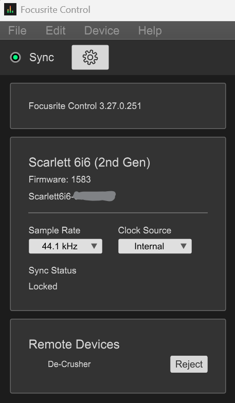

# Project: Focusrite De-Crusher

## 1. Background & Context

Many audio professionals and hobbyists (specifically e-kit drummers) leave their workstations and ASIO hosts running 24/7. However, a common issue arises with **Focusrite Scarlett** interfaces (and potentially others) during Windows power state transitions.

* **The Conflict:** When the Windows display turns off or enters sleep, a Power State change (D3) is broadcast over the PCIe bus. This frequently triggers a DPC latency spike that desynchronizes the Focusrite hardware clock from the active ASIO stream.
* **The Symptoms:** Audio becomes "robotic," "decimated," or "bit-crushed." This affects system-wide audio and, critically, low-latency ASIO outputs, persisting until a manual hardware reset occurs.
* **The Manual Fix:** Toggling the sample rate (e.g., 44.1kHz <-> 48kHz) in the Focusrite Control software forces a hardware PLL re-lock and resets the DMA pointers, immediately restoring clean audio.
* **The Objective:** Automate this "sample rate flip" seamlessly in the background when monitor power-down events are detected, ensuring the audio rig remains perfectly synchronized and ready to play at all times.

---

## 2. Technical Architecture - Scarlett 6i6 Gen2 (Sample-Rate Only, No Driver Restart)

Initial attempts to automate this by manipulating the Windows Core Audio `PKEY_AudioEngine_DeviceFormat` property failed. Because the ASIO host holds an exclusive hardware lock, the Focusrite driver ignores WDM-level sample rate changes. `SetupDi` `DICS_DISABLE/ENABLE` device restart was tested but crashes `Superior Drummer 3` (tears `Focusrite USB Audio` stream `DevInst 9/54`).

The working fix for **Scarlett 6i6 Gen2** is **Focusrite Control 1** `ControlServer.exe` TCP/XML sample-rate flip (no driver restart, SD3-safe):

### Core Components
1.  **Monitor State Detection:** 
    * A lightweight Win32 Tray Application uses `RegisterPowerSettingNotification` with `GUID_MONITOR_POWER_ON`.
    * It processes `WM_POWERBROADCAST` to detect when the monitor turns off.
    * Implements a 5-second sleep/timer after the "Off" event to allow the GPU and PCIe bus to settle into their idle power states before executing the audio reset.
2.  **Dynamic Port Discovery (6i6 Gen2):**
    * `Focusrite Control` background service (`ControlServer.exe`) listens on `127.0.0.1` ephemeral port.
    * `GetExtendedTcpTable` + `CreateToolhelp32Snapshot` locates `PID`/`port`, filtered for `127.0.0.1` loopback.
3.  **TCP/XML Sample-Rate Flip:**
    * `WinSock2` `Length=%06zx` framed `<client-details>` handshake (approve `De-Crusher` in `Focusrite Control` Remote Devices), `<device-subscribe devid="1">`, then `<set devid="1"><item id="905" value="48 kHz"/></set>` `2000ms PLL` `<item id="905" value="44.1 kHz"/>` with `select`/`recv` ACK. `src/LegacyControlServer.cpp:30` handles `SendAll` partials and `WaitForServerResponse` - no `DICS_*`, no `WinUSB` hub cycle.
4.  **Tray UI & Utilities:**
    * Standard `Shell_NotifyIcon` for background operation.
    * Provides a right-click context menu for "Manual De-Crush" and an option to enable verbose `-logs` via a spawned console window for troubleshooting.
    * Runs at `ABOVE_NORMAL_PRIORITY_CLASS` to prevent throttling during system idle transitions.

---

## 3. Usage & Setup (Scarlett 6i6 Gen2)

1. Install **Focusrite Control** (v1, for 6i6 Gen2 - not Control 2) and keep `ControlServer.exe` running
2. Run `build\Release\DeCrusher.exe` -> open `Focusrite Control` -> **Approve** `De-Crusher` in gear -> Remote Devices

   

3. Keep `DeCrusher` in tray (no admin needed - sample-rate flip, no driver restart, SD3-safe). Use `-logs` for verbose: `DeCrusher.exe -logs`. On monitor off (5s) or **Manual De-Crush** it flips `48kHz` `2s` `44.1kHz` via `ControlServer`; failures show balloon `NIIF_ERROR`.
---

## 4. Building from Source

This project requires **CMake** and **Visual Studio / MSVC**.

1. Clone the repository.
2. Double-click the `build.bat` file.
3. The compiled standalone executable will be generated at `build\Release\DeCrusher.exe`.
